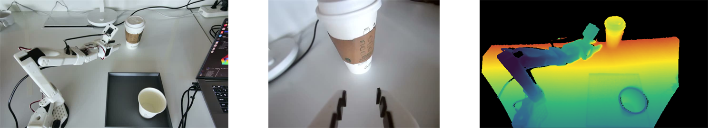
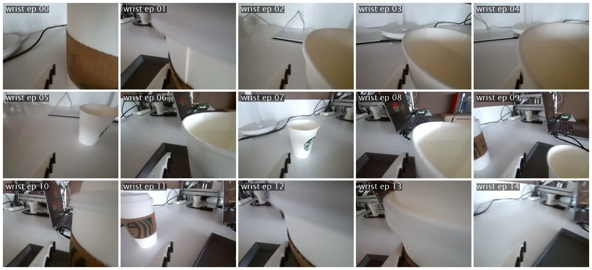
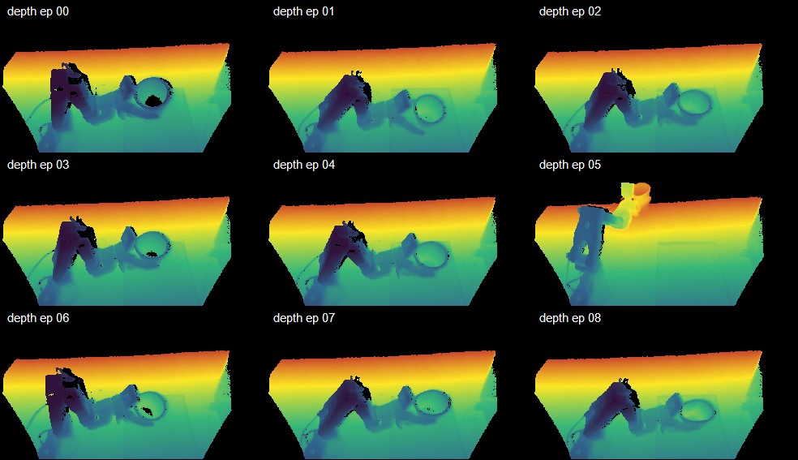

# Multimodal VLA Dataset Toolkit

[](https://huggingface.co/datasets/DerekLX/lerobot_derek_depth)
[](https://www.python.org/)
[](https://github.com/huggingface/lerobot)

This software project provides a multimodal VLA dataset toolkit for generating and auditing train-ready robotics datasets. It supports existing RGB-only datasets in the standard LeRobot ecosystem and RGB-D datasets with optional depth sidecars. RGB video is handled as a first-class data stream together with robot actions, states, metadata, and depth when available.

The toolkit is designed for Orbbec RGB-D collection, merging multiple same-structure LeRobot datasets into one real dataset, auditing RGB video/action/metadata quality with optional depth checks, building a cleaned copy from reviewed episode lists, and uploading the final dataset to Hugging Face.

It also includes a self-contained, **framework-free** data collection layer in `record/` that talks to the robot and cameras directly and writes LeRobot v3.0 datasets **without depending on the lerobot framework** — no "copy into a lerobot checkout" step:

- `record/rgb_record/`: RGB-only recording.
- `record/rgbd_record/`: Orbbec / Intel RealSense RGB-D recording, plus human-guided policy feedback.
- `record/visuo-tactile_record/`: visuo-tactile (vision + touch) recording, in progress.

The recorded datasets follow the standard LeRobot format (https://github.com/huggingface/lerobot) and flow straight into the merge / audit / clean / upload pipeline below. See [record/README.md](record/README.md) for the one-click recording guide. The visuo-tactile path under `record/visuo-tactile_record/` is in progress, and its dataset and toolkit will be released open source when ready.

## Dataset

The merged RGB-D VLA dataset is available on Hugging Face:

```text
https://huggingface.co/datasets/DerekLX/lerobot_derek_depth
```

Repository:

```text
DerekLX/lerobot_derek_depth
```

The Hugging Face dataset root is intended to contain the LeRobot subdirectories directly:

```text
data/
depth_sidecar/
meta/
videos/
```

## Dataset Preview

The examples below are sampled from one `pick_up_cups_dataset` episode with two cups in the scene.



Left to right: global robot collection view, wrist camera view, and front depth visualization.

Task data collection:

<video src="assets/readme/task_demo.mp4" controls width="720"></video>

If the video does not render in your Markdown viewer, open [task_demo.mp4](assets/readme/task_demo.mp4) directly.

Aligned episode overview matrices:

| Front camera, 9 sampled episodes |
| --- |
|  |

| Wrist camera, 9 sampled episodes |
| --- |
|  |

| Front depth matrix, 9 sampled episodes |
| --- |
|  |

## Repository Layout

The repository is organized by role:

```text
pipeline/               # production entry points: merge, audit, clean, feedback build,
                        #   language enrichment, policy iteration, HF upload
record/                 # framework-free recorder (no lerobot dependency):
                        #   recorder/ (self-contained library), camera_profiles.yaml/.py,
                        #   rgb_record/ (RGB-only), rgbd_record/ (Orbbec / RealSense RGB-D + feedback),
                        #   visuo-tactile_record/ (vision + touch, in progress)
tools/                  # local studios, depth visualization, structure-only checks
utils/                  # shared audit, metadata, media, and semantic helpers
semantic_backends/      # built-in --semantic-evaluator plugins (VLA checkpoint scoring)
policy_improvement/     # feedback capture, intervention, and policy iteration contracts
tests/                  # unit tests with synthetic datasets
configs/                # example configuration files
docs/                   # audit strategy and step-by-step operating playbook
assets/                 # README media
data/                   # local datasets (not tracked by git)
```

Offline pipeline modules never import LeRobot or camera SDKs. Robot-side
dependencies (cameras, Feetech motors) stay inside `record/`, which is now a
self-contained recorder run directly from this repository — no lerobot framework
and no copy-into-lerobot step.

Structural reports store a dataset fingerprint. `--semantic-only` refuses
to reuse a report when audit-relevant metadata or payload file identity has
changed.

## Overview

Main capabilities:

- collect RGB-only LeRobot datasets with a self-contained, framework-free recorder (no lerobot dependency);
- collect RGB-D data with switchable cameras (Orbbec Femto Bolt, Intel RealSense D405/D435, OpenCV);
- merge multiple LeRobot-style datasets into one physical dataset;
- keep the output as real files, not junctions or symbolic links;
- rewrite episode indices, frame indices, task indices, metadata, parquet tables, video references, and depth sidecars;
- audit RGB-only LeRobot datasets and RGB-D datasets with depth sidecars;
- audit RGB videos, optional depth sidecars, action/state tables, metadata completeness, and deterministic quality failures;
- parse detailed task descriptions into validated, editable semantic profiles;
- score episodes with a trained VLA policy checkpoint through the built-in
  action-consistency evaluator, including counterfactual instruction checks;
- run the local Task Semantic Studio for profile review and semantic audit setup;
- generate validated subtask, event, state, and summary language sidecars for approved trajectories;
- collect human recovery/correction feedback with explicit action provenance;
- build weighted feedback datasets without treating autonomous failures as expert actions;
- run plugin-based train, evaluate, promote, and deploy policy iterations;
- separate episodes into `keep`, `review`, and `drop` lists;
- build a clean train-ready dataset from `drop_episodes.txt`;
- upload the dataset to Hugging Face with resumable large-folder upload support;
- visualize depth PNG files for inspection.


## Getting Started

We recommend using a dedicated Python environment. Python 3.12 or newer is recommended if you also use the Orbbec RGB-D recorder.

Create and activate a conda environment:

```powershell
conda create -n vla_data_check python=3.12 -y
conda activate vla_data_check
```

Install Python dependencies:

```powershell
python -m pip install --upgrade pip
python -m pip install -r requirements.txt
```

Robot-side recording dependencies (cameras, Feetech motors) install from
`record/requirements.txt` and are torch-free; see the recording sections below.

Full video decoding and video trimming require `ffmpeg` and `ffprobe` command-line tools. If they are not already available in the environment, install them with conda:

```powershell
conda install -c conda-forge ffmpeg -y
ffmpeg -version
ffprobe -version
```

Enable faster Hugging Face uploads:

```powershell
$env:HF_XET_HIGH_PERFORMANCE="1"
```

## RGB Data Collection

Folder: `record/rgb_record/`. RGB-only capture for SO-100 / SO-101 arms, run directly from this repository — no lerobot dependency and no copy-in step. Depth-enabled cameras are rejected here; use `rgbd_record/` for depth.

Install the recorder dependencies (torch-free):

```powershell
python -m pip install -r record/requirements.txt
```

Find OpenCV camera indices, then set them (and the robot/leader serial ports) in `record/rgb_record/configs/head_wrist_rgb_record.yaml`:

```powershell
python .\record\rgbd_record\find_cameras.py opencv
```

Calibration uses lerobot's own cache location, so arms already calibrated with lerobot work unchanged. To calibrate a new arm, add `--calibrate` to the teleoperate command.

Teleoperate (leader → follower preview), then record:

```powershell
python .\record\rgb_record\rgb_teleoperate.py --config_path=.\record\rgb_record\configs\head_wrist_rgb_teleoperate.yaml
python .\record\rgb_record\rgb_record.py --config_path=.\record\rgb_record\configs\head_wrist_rgb_record.yaml
```

Select cameras from the shared inventory with `--camera_profile=rgb_head_wrist`, override any field inline (e.g. `--dataset.num_episodes=5`), or add `--mock` for an offline dry-run. Recording keys: Right = end episode, Left = re-record, Esc = stop.

The output is a standard LeRobot RGB dataset with `data/`, `meta/`, and `videos/` and no `depth_sidecar/`. After recording, point this toolkit's merge, audit, clean, and upload scripts at the dataset root.

## RGB-D Data Collection (Orbbec / RealSense)

Folder: `record/rgbd_record/`. RGB-D capture with an Orbbec Femto Bolt or an Intel RealSense D405 / D435 / D435i, run directly from this repository — no lerobot dependency and no copy-in step. This makes the pipeline cover capture → merge → audit → clean → upload. RGB streams are stored as mp4 video; any camera with `use_depth: true` contributes a lossless uint16 PNG depth sidecar under `depth_sidecar/`, with a manifest at `meta/rgbd_vla_depth_recording.json`.

Camera hardware facts (backend type, serial number, resolution, depth on/off) are defined once in the shared inventory `record/camera_profiles.yaml`, which serves all recording paths (RGB, RGB-D, visuo-tactile). At record time, `--camera_profile=<name>` swaps the whole camera set without touching the record config; supported backends are `orbbec`, `intelrealsense` (D405/D435), and `opencv`. Cameras can also stay inline in the recording YAML: `record_rgbd.yaml` ships with the Orbbec block active, and `record_rgbd_realsense.yaml` is a ready-to-run all-RealSense rig (D435 front + D405 wrist).

Scope: this folder is for data collection only — an Orbbec camera backend, RealSense-compatible depth wiring in the SO follower, RGB-D recording, and depth sidecar storage. It does not contain this project's depth model training or inference implementation.

Install the recorder plus the camera SDK you use:

```powershell
python -m pip install -r record/requirements.txt
pip install pyorbbecsdk2      # and/or: pip install pyrealsense2
```

Find the cameras and write the serials/ports into `record/rgbd_record/configs/record_rgbd.yaml` (or `record_rgbd_realsense.yaml`):

```powershell
python .\record\rgbd_record\find_cameras.py orbbec
python .\record\rgbd_record\find_cameras.py realsense
```

Record:

```powershell
python .\record\rgbd_record\record.py --config_path=.\record\rgbd_record\configs\record_rgbd.yaml
```

Add `--camera_profile=<name>` to pick a camera set from the shared inventory, or `--mock` for an offline dry-run (synthetic cameras and joints). Depth is saved as lossless uint16 PNG sidecars under `depth_sidecar/`, with a recording manifest at `meta/rgbd_vla_depth_recording.json`.

## Merge Datasets

Use `dataset_merge.py` to merge multiple `*_dataset` folders into one real LeRobot dataset.

```powershell
python ./pipeline/dataset_merge.py `
  --src-root . `
  --out-dir .\lerobot_derek_depth `
  --dataset-glob "*_dataset" `
  --copy-mode copy
```

Overwrite an existing output:

```powershell
python ./pipeline/dataset_merge.py --out-dir .\lerobot_derek_depth --overwrite
```

## Audit Dataset Quality

Use `data_quality_audit.py` to run conservative quality checks. Hard deterministic failures are marked as `drop`; suspicious but uncertain episodes are marked as `review`. The audit never deletes source data.

RGB is in scope. The audit checks RGB video existence, real-file status, empty files, ffprobe dimensions/codec when available, full ffmpeg decode when requested, and sampled black/white/near-constant/frozen video content. Content sampling is confined to each episode's own `from_timestamp`/`to_timestamp` range, so episodes sharing one aggregated video file receive independent verdicts. Existing RGB-only LeRobot datasets do not need a `depth_sidecar/` directory. When depth sidecars are present, the audit checks them separately through PNG structure, dimensions, optional full decode, invalid-depth ratio, and constant-depth samples.

```powershell
python ./pipeline/data_quality_audit.py .\lerobot_derek_depth
```

Default audit output:

```text
quality_audit_reports/lerobot_derek_depth/
  quality_report.csv
  quality_summary.json
  keep_episodes.txt
  review_episodes.txt
  drop_episodes.txt
```

Run with video decode and sampled content checks:

```powershell
python ./pipeline/data_quality_audit.py .\lerobot_derek_depth `
  --depth-check header `
  --video-check decode `
  --video-content-check sample `
  --sample-frames 8 `
  --depth-sample-frames 8
```

## Task Semantic Studio

Use the local task window to turn a detailed natural-language description into
a validated, editable semantic profile:

~~~powershell
python ./tools/task_semantic_studio.py
~~~

The Profile directory is optional when running an audit. Leave it blank to
send the dataset task text and all available episode videos directly to the
evaluator with the global failure and pass thresholds. Select a Profile
directory to add task-specific stages, success criteria, preferred video keys,
and threshold overrides.

Recommended profile-enhanced workflow:

1. Enter the exact dataset task text in Dataset task text / name.
2. Write a detailed task description, including the ordered actions and final
   observable success state.
3. Select Parse description. The dependency-free local parser creates a draft
   containing objects, stages, observable conditions, and success/failure
   criteria.
4. Review the generated JSON. Add aliases when the dataset may use another
   exact task string. Set calibrated review_threshold and pass_threshold
   overrides only when labeled validation data is available.
5. Validate and save the profile into task_profiles/.
6. Select the dataset and evaluator plugin, keep the Profile directory selected,
   then run the audit from the same window. Clear the Profile directory to run
   without Profile matching.

The local parser is deliberately conservative and its output is a draft. It
does not invent a confidence threshold. A stronger parser can be installed as
a module:attribute plugin and selected in the window without changing the
audit code.

Each saved profile contains:

- task_key, task_name, instruction, and aliases used for exact task matching;
- objects and attributes;
- ordered stages with observable video conditions and optional weights;
- final success and failure criteria;
- optional preferred_video_keys and task-specific review_threshold and
  pass_threshold values.

When a Profile directory is configured, the task name or one alias must match
the task text referenced by the episode's task_index; an unmatched task is sent
to review. Without a Profile directory, matching is skipped and the evaluator
receives task_profile=None. In both modes, an episode containing multiple
distinct task texts is sent to review until it is segmented, rather than
receiving one ambiguous semantic score.

## Optional Semantic Quality Evaluation

The deterministic audit can optionally call a project-defined semantic
evaluator. The base installation does not download model weights and remains
fully usable when no evaluator is configured.

An evaluator receives the task text plus episode-scoped video files and their
start/end timestamps. It returns a normalized progress curve, a final success
probability, and optionally a named failure stage:

~~~python
class MySemanticEvaluator:
    name = "my_video_language_evaluator"

    def evaluate(self, episode):
        # Run an external or local video-language scoring model here.
        return {
            "progress_curve": [0.05, 0.30, 0.62],
            "success_probability": 0.41,
            "failure_stage": "grasp",
            "details": {"model_revision": "local"},
        }
~~~

Expose either an evaluator instance, an evaluator class, or a factory from a
Python module, then enable it with module:attribute syntax:

~~~powershell
python ./pipeline/data_quality_audit.py ./lerobot_derek_depth --semantic-evaluator my_quality_backend:create_evaluator --semantic-config ./semantic_evaluator.json --semantic-failure-threshold 0.5 --semantic-pass-threshold 0.9
~~~

`--semantic-review-threshold` remains accepted as a compatibility alias for
`--semantic-failure-threshold`.

Add `--task-profile-dir ./task_profiles` when task-specific matching and
protections are required.

~~~mermaid
flowchart TD
    A[Task text and episode videos] --> B{Profile directory configured?}
    B -- No --> C[Use all available videos and global thresholds]
    B -- Yes --> D{Task Profile matched?}
    D -- No --> E[Send episode to review]
    D -- Yes --> F[Use Profile stages, preferred views, and threshold overrides]
    C --> G[Semantic evaluator]
    F --> G
    G --> H[Progress, success probability, and failure stage]
    H --> I{Score below failure threshold?}
    I -- Yes --> J[Likely failure review]
    I -- No --> K{Score below pass threshold?}
    K -- Yes --> L[Uncertain score review]
    K -- No --> M[Semantic pass]
~~~

The evaluator configuration file is optional and must contain one JSON object.
Classes receive the object as keyword arguments; factories receive it as one
dictionary.

An evaluator also receives the episode's action and state arrays through
`episode.motion`, so a backend can compare what the instruction says against
what the arm actually did without re-reading parquet.

### Built-in backend: score with a trained VLA checkpoint

The toolkit ships one ready-to-use evaluator that turns a trained VLA policy
checkpoint (a lerobot pretrained-policy directory such as pi05, smolvla, or
act) into a data-quality scorer. A policy has no yes/no interface, so it is
scored by **instruction-conditioned action consistency**: at sampled anchor
frames the policy predicts a short action chunk from the camera frames, joint
state, and task text, and the score measures how much better than a
hold-position baseline the prediction matches the actions the demonstrator
actually executed (1.0 reproduces the demonstration, 0.0 is no better than
freezing). The same anchors are re-scored under deliberately corrupted
instructions (reversed verb, swapped direction, color, or object) to fill
`details.counterfactual_margin`: an episode whose actions are predicted
equally well under a wrong instruction is not grounded in its language label
and goes to review. Interleaved anchor subsets fill `score_samples`, so
agreement that swings across the episode is demoted to review by the
dispersion contract. No progress curve is returned, so the progress-shape and
stage-order checks correctly report themselves as not-checked.

~~~powershell
python ./pipeline/data_quality_audit.py ./lerobot_derek_depth `
  --semantic-evaluator semantic_backends.vla_checkpoint_evaluator:create_evaluator `
  --semantic-config ./configs/vla_checkpoint_evaluator.example.json
~~~

The configuration names the checkpoint and the optional knobs
([configs/vla_checkpoint_evaluator.example.json](configs/vla_checkpoint_evaluator.example.json)):

~~~json
{
  "policy_path": "checkpoint for audit/pretrained_model",
  "device": "cuda",
  "anchors": 6,
  "eval_horizon": 10,
  "sample_splits": 3,
  "max_counterfactuals": 3,
  "camera_map": {"front": "head", "wrist": "right_wrist"}
}
~~~

- `policy_path` is a lerobot pretrained-policy directory. Loading it needs the
  policy runtime (`pip install lerobot` plus the policy's own extras), so run
  this stage in the training environment — ideally as `--semantic-only` on top
  of a structural report produced in the base environment.
- `camera_map` renames dataset cameras to the names the policy was trained
  with when they differ (for example `{"front": "head"}`).
- The score means "this checkpoint can reproduce this demonstration". A low
  score can also mean the episode is merely out-of-distribution for the
  current policy, so calibrate the failure/pass thresholds on human-labelled
  episodes before trusting automatic passes. `--semantic-per-view` is not
  useful with this backend: the policy needs every camera it was trained with
  inside one observation.

Task text is resolved from `meta/tasks.parquet` whether the string lives in an
explicit `task` column or in the pandas index artifact `__index_level_0__`, and
episode rows are located correctly in both layouts: one parquet file per
episode (merge outputs) and aggregated files holding many episodes (recorded
v3 datasets), sliced by the episode's global frame range.

### Score reliability contracts

Three optional contracts let a backend say how much its own score should be
trusted; each is review-only and reports itself as not-checked when unused:

- **Sampling dispersion**: return `score_samples` (repeated scorings across
  temperatures or frame subsets) or an explicit `score_std`. Dispersion at or
  above `--semantic-uncertainty-threshold` (default 0.15) demotes a pass to
  review as `semantic_score_unstable_review`. A backend that returns only
  samples gets `success_probability` derived as their mean.
- **Counterfactual margin**: return `details.counterfactual_margin` — the score
  of the true instruction minus the best score among deliberately corrupted
  instructions (swapped object, swapped target, reversed direction). A margin
  below `--semantic-counterfactual-margin-threshold` (default 0.10) is reviewed
  as `semantic_counterfactual_margin_low_review`: the episode is mislabeled,
  ambiguous, or the evaluator cannot discriminate. Distractor generation stays
  in the backend.
- **Per-view agreement**: pass `--semantic-per-view` to additionally score each
  camera view separately (one extra evaluator call per view). A gap at or above
  `--semantic-view-disagreement-threshold` (default 0.30) between views is
  reviewed as `semantic_view_disagreement_review` — one camera saw something
  the other did not, so neither single score should be trusted. The combined
  result stays authoritative.

Semantic output is added directly to quality_report.csv:

- semantic_progress_curve_json
- semantic_progress_final
- semantic_success_probability
- semantic_score
- semantic_failure_stage
- semantic_status and semantic_evaluator
- semantic_task_profile, semantic_review_threshold, and semantic_pass_threshold
- semantic_progress_max_drop and semantic_progress_idle_tail_ratio
- semantic_stage_timeline_source
- semantic_motion_verbs and semantic_motion_gripper_transitions
- semantic_score_uncertainty, semantic_view_disagreement, and
  semantic_counterfactual_margin

Success probability is used as the review score when provided; otherwise the
last progress value is used. The default decision bands are:

- score below 0.5: semantic_low_score_review;
- score from 0.5 up to, but not including, 0.9:
  semantic_uncertain_score_review;
- score at or above 0.9: semantic pass.

Both lower bands go to review and never turn a trajectory into a hard drop.
Only the upper band can enter keep when no other issue exists. These defaults
are conservative gates, not proof that the score is calibrated: before relying
on automatic pass, measure false-positive rates on human-labeled episodes and
continue sampling high-scoring episodes for manual review. Evaluator errors
also go to review so model failures cannot silently approve data. Episodes
already marked drop by deterministic checks skip semantic inference.

## Model-Free Semantic Consistency Checks

A second group of semantic checks needs no evaluator and no model weights. They
read the progress curve, the ordered stages of a Task Profile, and the
action/state streams the audit has already loaded. Every finding is review-only,
and every check reports itself as not-checked when its preconditions are absent
rather than passing silently.

Progress-curve shape (requires an evaluator, since it reads the curve):

- `semantic_progress_regression_review`: the curve drops by 0.15 or more at some
  point, which is what a dropped object or a retry looks like. This fires even
  when the final score passes, so recoveries stay visible.
- `semantic_progress_idle_tail_review`: the curve reaches 0.95 with 30% or more
  of the episode still to run, so the tail is post-completion idling and the
  episode is a trimming candidate.
- `semantic_progress_idle_head_review`: progress does not start until halfway
  through the episode.

Stage ordering (requires an evaluator and `--task-profile-dir`):

- `semantic_stage_order_violation_review`: the stage sequence goes backwards. An
  evaluator can supply an explicit `details["stage_timeline"]`; otherwise the
  timeline is derived from the progress curve against the cumulative stage
  weights, and a backwards step only counts when the accompanying drop is larger
  than curve noise.
- `semantic_stage_skipped_review`: an intermediate stage is never visited.
- `semantic_stage_unknown_review`: an explicit timeline names a stage that is
  absent from the Task Profile.
- `semantic_stage_dwell_outlier_review`: one stage lasted far longer or shorter
  than the median for that task and stage across the dataset. A deviation must
  clear both a robust MAD band and an absolute floor, so a tight distribution
  does not turn ordinary jitter into findings.

Action/language consistency (needs no evaluator at all):

- `semantic_motion_gripper_pattern_review`: the verb in the task text and the
  observed gripper actuation disagree. A pick task with no gripper transition, or
  a push task with a full grasp cycle, is flagged.
- `semantic_motion_vertical_direction_review`: a directional verb such as lift or
  press moved the declared vertical axis the wrong way.

~~~powershell
python ./pipeline/data_quality_audit.py ./lerobot_derek_depth `
  --motion-check signature `
  --motion-vertical-index 2
~~~

The gripper channel is auto-detected as the action dimension that spends nearly
all of its time at one of two levels; use `--motion-gripper-index` to declare it
instead. Transitions are counted between the two levels the channel actually
visits, so no assumption is made about whether a high value means open or closed.
An episode whose gripper barely moves relative to the dataset median is treated
as unactuated rather than as a sequence of noise-driven grasps.

Verbs are matched from a built-in English/Chinese lexicon. Unmatched verbs,
conflicting verbs (`pick up the sponge and wipe the table`), an unresolvable
gripper channel, and an unconfigured vertical axis all record a
`semantic_motion_*` entry in `not_checked` instead of a finding. Use
`--motion-check none` to turn the group off.

All of these reasons use the `semantic_` prefix, so `--semantic-only` replaces
them on a rerun instead of accumulating them, and they never change
`structural_status`. Counts per check are written to the `semantic_consistency`
block of `quality_summary.json` so each check's precision can be measured on its
own before its thresholds are tuned.

### Staged Audits: Reuse the Structural Report

Deterministic checks are cheap to re-run; semantic evaluation is the expensive
layer. For day-to-day iteration, run them as two stages instead of one pass:

1. Run the deterministic audit alone (no `--semantic-evaluator`). Fix
   structural problems, rebuild, and re-run until the dataset is structurally
   clean.
2. Re-run only the semantic layer on top of the saved report:

~~~powershell
python ./pipeline/data_quality_audit.py ./lerobot_derek_depth `
  --semantic-only `
  --semantic-evaluator my_quality_backend:create_evaluator `
  --semantic-failure-threshold 0.5 `
  --semantic-pass-threshold 0.9
~~~

`--semantic-only` reloads `<out-dir>/quality_report.csv` (override the source
with `--reuse-report path/to/quality_report.csv`), preserves every structural
finding, strips prior semantic results, and evaluates only episodes that are
not already structural drops. The merged report overwrites
`quality_report.csv` and the keep/review/drop lists, and
`quality_summary.json` records `audit_mode: semantic_reuse` together with the
reused report path.

Safety rules in this mode:

- the dataset must be unchanged since the reused report was produced: the
  episode set, per-episode lengths, and the dataset path recorded in the prior
  `quality_summary.json` are re-checked, and any mismatch fails the run
  instead of producing a stale report;
- `--feedback-sidecar` is rejected because feedback alignment is a structural
  check; run it in stage 1;
- before publishing a dataset, run one final full audit in a single pass so
  the released report does not depend on report reuse.

The step-by-step operating procedure with commands is in
[docs/audit_operations_playbook.md](docs/audit_operations_playbook.md).

## Trajectory Language Enrichment

The third layer describes what happens inside an approved trajectory; it does
not decide whether the trajectory is good or bad. Run it after deterministic
and semantic quality review so annotation compute is spent only on usable data:

~~~mermaid
flowchart TD
    A[Quality report] --> B{Episode selection}
    B -- Default --> C[keep episodes]
    B -- Human-approved list --> D[keep and approved review episodes]
    B -- drop episode --> E[Reject]
    C --> F[Optional Task Profile plus annotator plugin]
    D --> F
    F --> G[Validate frame ranges, ordering, and language fields]
    G --> H[Write external language sidecars]
~~~

Launch the local setup window:

~~~powershell
python ./tools/trajectory_language_studio.py
~~~

Or call the processor directly. The quality report defaults to
`quality_audit_reports/<dataset_name>/quality_report.csv` when omitted:

~~~powershell
python ./pipeline/trajectory_language_enrichment.py ./robot_dataset `
  --quality-report ./quality_audit_reports/robot_dataset/quality_report.csv `
  --task-profile-dir ./task_profiles `
  --annotator my_language_backend:create_annotator `
  --annotator-config ./language_annotator.json
~~~

An annotator plugin receives exactly one task, episode-local frame count,
episode-scoped video segments, an optional Task Profile, and the corresponding
semantic quality context. It returns time-aligned language fields:

~~~python
class MyLanguageAnnotator:
    name = "my_language_annotator"

    def annotate(self, episode):
        return {
            "subtasks": [
                {
                    "start_frame": 0,
                    "end_frame": 45,
                    "stage": "approach",
                    "text": "approach the red cup",
                }
            ],
            "events": [
                {
                    "frame_index": 46,
                    "event": "gripper_closing",
                    "description": "The gripper starts closing around the cup.",
                }
            ],
            "state_descriptions": [
                {
                    "start_frame": 0,
                    "end_frame": 46,
                    "level": "state",
                    "text": "The gripper moves from free space toward the cup.",
                }
            ],
            "summary": "The robot approaches the cup and begins the grasp.",
        }
~~~

By default only rows whose final quality status is `keep` are processed. Use
`--approved-episodes approved_episodes.txt` after human review to explicitly
include selected `review` episodes. An episode whose quality status is `drop`
is rejected even if it appears in that file. When `quality_summary.json` is
available beside the CSV, its dataset path must match the selected dataset;
episode lengths are also cross-checked when present in the report.

Outputs are external sidecars; the source dataset is never modified:

~~~text
language_enrichment_outputs/<dataset_name>/
  enrichment_manifest.json
  language_annotations.jsonl
  subtasks.jsonl
  events.jsonl
  state_descriptions.jsonl
  subtask_boundary_alignment.jsonl
  annotations/
    episode-000000.json
~~~

All generated annotations are validated for local frame bounds, chronological
ordering, non-overlapping subtasks, required text, confidence ranges, and JSON
serializability. Each annotation also records its second-layer quality context;
when a Task Profile is configured, named subtask stages must belong to that
Profile. The framework deliberately does not fabricate annotations without an
annotator plugin. Automatically generated language remains model output and
should be sampled for human verification before training.

Generated subtask boundaries are additionally checked against the arm itself.
Change points are taken from gripper level changes and from local minima of the
non-gripper action speed that fall in the slowest quartile of the episode; a
boundary counts as aligned when it sits within `--boundary-tolerance-frames` of
one. Boundaries invented by a language model tend to land in the middle of a
smooth motion, so an episode where fewer than half of the boundaries align is
recorded as `language_subtask_boundary_unaligned_review` in
`subtask_boundary_alignment.jsonl`, with counts in the manifest. Use
`--boundary-check none` to skip it, and `--motion-gripper-index` to declare the
gripper channel rather than relying on detection.

## Closed-Loop Policy Improvement

The fourth layer collects targeted human feedback from states visited by a
deployed policy. It uses project-owned names and contracts rather than exposing
an upstream deployment command. The default path records only human recovery
and correction frames, so autonomous failure actions cannot silently become
expert targets.

### Collect human-guided RGB-D feedback

Use the dedicated feedback entrypoint, run directly from this repository — no
copy-in step:

~~~powershell
python ./record/rgbd_record/feedback_record.py `
  --config_path=./record/rgbd_record/configs/record_rgbd_feedback.yaml `
  --policy.path=./outputs/train/run/checkpoints/last/pretrained_model
~~~

Teleoperated capture, intervention labelling, and the feedback sidecar are fully
framework-free (they reuse `policy_improvement/`). Only the in-loop policy
inference uses a policy runtime, isolated behind
`recorder.policy_runner.PolicyRunner`: the default adapter lazily imports
`lerobot` to run any lerobot checkpoint (`pip install lerobot`), and you can
supply a custom `PolicyRunner` to drive any other policy stack with no lerobot
dependency. Add `--mock` for an offline dry-run with a stub policy.

The default keyboard workflow is:

1. `i`: pause autonomous control, align the actuated teleoperator, and begin
   Recovery.
2. `c`: mark the first Correction frame after at least one Recovery frame.
3. `i`: complete the correction, save the feedback episode, reset policy state,
   and return control to the policy.
4. `esc`: request a clean session stop. A stop request never cuts an active
   intervention in half.

Automatic alignment is required by default. A passive or unsupported
teleoperator is rejected instead of moving the follower to an unverified pose.
Hardware-specific systems can provide another handover adapter, but must verify
leader/follower synchronization and emergency-stop behavior on the real robot.

Three capture modes are available in
`record/rgbd_record/configs/record_rgbd_feedback.yaml`:

- `corrections_only`: records Recovery and Correction frames only. These frames
  are marked training-eligible and this is the recommended first deployment.
- `event_buffer`: retains a bounded pre-event window. Press `h` to start/stop a
  manual event capture; a takeover also flushes the pre-event window. Autonomous
  frames are retained for analysis but remain ineligible as expert targets.
- `continuous`: records autonomous and human-controlled frames and rotates
  episodes by time without resetting policy state at rotation boundaries.
  Autonomous frames remain ineligible by default.

Each capture session writes an external sidecar:

~~~text
feedback_outputs/<dataset>/<session>/
  session_manifest.json
  frame_feedback.parquet
  episode_feedback.jsonl
  intervention_segments.jsonl
~~~

The frame sidecar records `phase`, `intervention_id`, trigger source, the
policy-proposed action, the action actually executed, and whether the frame may
be used as an expert target. The dataset's normal `action` remains the action
actually sent to the robot.

### Audit feedback alignment

Pass the feedback sidecar into the existing deterministic and semantic audit:

~~~powershell
python ./pipeline/data_quality_audit.py ./data/so100_rgbd_feedback `
  --feedback-sidecar ./feedback_outputs/so100_rgbd_feedback/session-001 `
  --semantic-evaluator my_quality_backend:create_evaluator `
  --semantic-failure-threshold 0.5 `
  --semantic-pass-threshold 0.9
~~~

In addition to the normal RGB, depth, action, state, timestamp, and semantic
checks, the audit validates sidecar/dataset episode lengths, contiguous frame
indices, intervention ranges, phase labels, and training eligibility. Feedback
outcomes such as `aborted`, `failure`, or `pending_review` enter review.

The resulting `quality_report.csv` exposes feedback counts in `metrics_json`.
The language enrichment layer already forwards this metrics object to its
annotator, allowing Recovery/Correction events to receive task-stage language
without changing the source dataset.

Newly recorded feedback has `review_status=pending`, so the audit sends it to
review even when structural checks pass. After inspection, write the accepted
episode indices into a separate approval list; that list is the human approval
record and does not mutate the capture sidecar.

### Build the feedback training dataset

After review and optional language enrichment, build a new physical training
dataset:

~~~powershell
python ./pipeline/feedback_dataset_build.py `
  --base-dataset ./data/original_clean_dataset `
  --feedback-dataset ./data/so100_rgbd_feedback `
  --feedback-sidecar ./feedback_outputs/so100_rgbd_feedback/session-001 `
  --quality-report ./quality_audit_reports/so100_rgbd_feedback/quality_report.csv `
  --approved-episodes ./approved_feedback_episodes.txt `
  --language-enrichment ./language_enrichment_outputs/so100_rgbd_feedback `
  --out-dir ./iteration_datasets/iteration-001
~~~

Default selection includes only `keep` feedback episodes whose sidecar review
status is already approved. Pass `--approved-episodes` to record explicit human
approval for pending/review episodes; a `drop` or human-rejected episode is
always rejected. The standard builder accepts corrections-only
episodes and refuses event/continuous episodes containing autonomous frames
until they are segmented, preventing label contamination.

The output contains:

~~~text
iteration_datasets/iteration-001/
  data/
  meta/
  videos/
  depth_sidecar/
  feedback_build_manifest.json
  training_sidecars/
    training_weights.parquet
    language_annotations.jsonl   # when supplied
~~~

Base demonstrations receive weight `1.0`, Recovery defaults to `1.0`, and
Correction defaults to `2.0`. These are external sampling hints; a trainer must
explicitly opt into the weights. The manifest records source datasets, episode
mapping, quality selection, language provenance, and confirms that autonomous
failure actions were not used as expert targets.

### Optional asynchronous event triggers

`event_buffer` can load a calibrated window evaluator through
`module:attribute` configuration. The evaluator receives a snapshot of recent
packets and returns a trigger signal:

~~~python
class MyWindowEvaluator:
    name = "my_window_evaluator"

    def evaluate_window(self, packets):
        return {
            "triggered": False,
            "source": "semantic",
            "score": 0.8,
            "reason": "",
        }
~~~

Inference runs in a single background worker and never blocks the control loop.
It is disabled in the example configuration. Enable it only after measuring
false positives and false negatives on human-labelled windows. Automatic
triggers save data; they do not automatically transfer robot control.

### Train, evaluate, promote, and deploy

`policy_iteration.py` keeps model-specific commands behind three plugins:

~~~python
class MyTrainer:
    def train(self, request): ...

class MyEvaluator:
    def evaluate(self, request): ...

class MyDeployer:
    def deploy(self, request): ...
~~~

Run one iteration from a JSON configuration:

~~~powershell
python ./pipeline/policy_iteration.py ./configs/policy_iteration.example.json
~~~

Promotion requires the configured success rate, intervention rate, critical
failure limits, and a separate human approval file. Deployment is not called
when any gate fails. Every stage updates `iteration_manifest.json`, making the
checkpoint, metrics, promotion decision, deployment target, and failure state
auditable. Plugin configuration is not copied into the manifest, avoiding
accidental persistence of credentials.

## Check Completeness

Use `tools/dataset_completeness_check.py` for structure-only validation after merging or cleaning.

```powershell
python ./tools/dataset_completeness_check.py .\lerobot_derek_depth
```

## Build a Clean Dataset

Use `dataset_clean_build.py` to create a new physical dataset from `drop_episodes.txt`. The original dataset is preserved.

Recommended workflow:

1. Run the quality audit.
2. Inspect `quality_report.csv` and `review_episodes.txt`.
3. Add manually confirmed bad episodes to `drop_episodes.txt`.
4. Build the clean dataset.

```powershell
python ./pipeline/dataset_clean_build.py `
  .\lerobot_derek_depth `
  --drop-list .\quality_audit_reports\lerobot_derek_depth\drop_episodes.txt `
  --out-dir .\lerobot_derek_depth_clean `
  --video-mode trim-reencode
```

Notes:

- `trim-reencode` trims videos per kept episode and physically removes dropped episode segments.
- `copy-referenced` is faster, but copied mp4 files may still contain unreferenced old segments.
- The output includes `cleaning_manifest.json`.

## Upload to Hugging Face

Use `hf_push.py` to upload a local dataset directory to a Hugging Face Dataset repository.

Recommended token setup:

```powershell
$env:HF_TOKEN="hf_your_write_token"
```

The script also contains editable local defaults:

```python
HF_USERNAME = "your_huggingface_username"
HF_WRITE_TOKEN = "hf_your_write_token_here"
HF_DATASET_NAME = "your_dataset_name"
```

Always run a dry run first:

```powershell
python ./pipeline/hf_push.py --dry-run
```

Upload:

```powershell
$env:HF_XET_HIGH_PERFORMANCE="1"
python ./pipeline/hf_push.py
```

Upload a cleaned dataset instead:

```powershell
python ./pipeline/hf_push.py `
  --dataset-dir .\lerobot_derek_depth_clean `
  --dataset-name lerobot_derek_depth_clean
```

## Visualize Depth

Use `depth_visualize.py` to inspect depth PNG statistics or generate visualization images.

Print statistics:

```powershell
python ./tools/depth_visualize.py .\lerobot_derek_depth\depth_sidecar --stats
```

Generate visualization images:

```powershell
python ./tools/depth_visualize.py .\lerobot_derek_depth\depth_sidecar --out .\depth_vis
```

## Run Tests

The repository includes a small synthetic LeRobot RGB-D dataset test. It does not use the real local datasets.

```powershell
python -m unittest discover -s tests
```

## Dataset Citation

If this dataset is useful for your work, please cite or link the Hugging Face dataset:

```bibtex
@dataset{dereklx_lerobot_derek_depth_2026,
  author    = {DerekLX},
  title     = {lerobot_derek_depth},
  year      = {2026},
  publisher = {Hugging Face},
  url       = {https://huggingface.co/datasets/DerekLX/lerobot_derek_depth}
}
```
