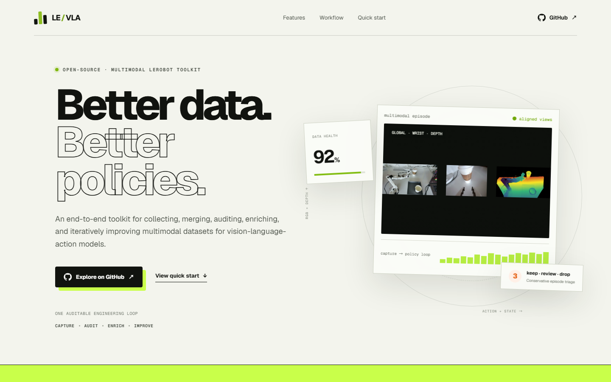

# LeRobot RGB / RGB-D VLA Dataset Toolkit



An end-to-end toolkit for building train-ready LeRobot datasets for
vision-language-action models. It closes one auditable loop — **capture → audit → enrich → improve** —
so every dataset decision, from a dropped episode to a promoted policy, stays traceable.

Project page: <https://dataset-toolkit-vlanything.derek-xia.chatgpt.site/>

[](https://huggingface.co/datasets/DerekLX/lerobot_derek_depth)
[](https://www.python.org/)
[](https://github.com/huggingface/lerobot)

## Dataset Preview

Sampled from one `pick_up_cups_dataset` episode with two cups in the scene.


Left to right: global collection view, wrist camera view, and front depth visualization.

| Front camera, 9 sampled episodes | Wrist camera, 9 sampled episodes |
| --- | --- |
|  |  |

Published datasets:

- RGB-D: [DerekLX/lerobot_derek_depth](https://huggingface.co/datasets/DerekLX/lerobot_derek_depth)
- RGB-only: [dadm022/lerobot_rgb_vla](https://huggingface.co/datasets/dadm022/lerobot_rgb_vla) — 2,318 episodes, 2.49M frames

## Repository Layout

```text
pipeline/               # production entry points: merge, audit, clean, feedback build,
                        #   language enrichment, policy iteration, HF upload
record/                 # robot + camera capture, writes LeRobot datasets:
                        #   recorder/ (self-contained library), camera_profiles.yaml/.py,
                        #   rgb_record/ (RGB-only), rgbd_record/ (Orbbec / RealSense RGB-D + feedback),
                        #   visuo-tactile_record/ (vision + touch, in progress)
tools/                  # local studios, depth visualization, structure-only checks
utils/                  # shared audit, metadata, media, and semantic helpers
semantic_backends/      # built-in --semantic-evaluator plugins (VLA checkpoint scoring)
policy_improvement/     # feedback capture, intervention, and policy iteration contracts
tests/                  # unit tests with synthetic datasets
configs/                # example configuration files
docs/                   # audit strategy and step-by-step operating playbook
assets/                 # README media
data/                   # local datasets (not tracked by git)
```

## Getting Started

Python 3.12 or newer is recommended if you also use the Orbbec RGB-D recorder.

```powershell
conda create -n vla_data_check python=3.12 -y
conda activate vla_data_check
python -m pip install --upgrade pip
python -m pip install -r requirements.txt
```

Video decoding and trimming require `ffmpeg` / `ffprobe`:

```powershell
conda install -c conda-forge ffmpeg -y
```

Robot-side recording dependencies (cameras, Feetech motors) install separately from
`record/requirements.txt` and are torch-free.

## 1. Record

Both recorders run directly from this repository and write standard LeRobot datasets.
See [record/README.md](record/README.md) for the one-click guide.

**RGB-only** (`record/rgb_record/`) — SO-100 / SO-101 arms; depth-enabled cameras are rejected here.

```powershell
python .\record\rgbd_record\find_cameras.py opencv
python .\record\rgb_record\rgb_record.py --config_path=.\record\rgb_record\configs\head_wrist_rgb_record.yaml
```

**RGB-D** (`record/rgbd_record/`) — Orbbec Femto Bolt or Intel RealSense D405 / D435 / D435i.
RGB streams are stored as mp4; any camera with `use_depth: true` also writes lossless uint16 PNG
depth sidecars under `depth_sidecar/`, with a manifest at `meta/rgbd_vla_depth_recording.json`.

```powershell
python .\record\rgbd_record\find_cameras.py orbbec
python .\record\rgbd_record\record.py --config_path=.\record\rgbd_record\configs\record_rgbd.yaml
```

Add `--camera_profile=<name>` to pick a camera set from the shared inventory, or `--mock` for an
offline dry run. Recording keys: Right = end episode, Left = re-record, Esc = stop.

The visuo-tactile path under `record/visuo-tactile_record/` is in progress and will be released
open source when ready.

## 2. Merge

`dataset_merge.py` merges multiple same-structure datasets into one **real** LeRobot dataset —
not a folder of folders. It rewrites episode indices, frame indices, task indices, metadata,
parquet tables, video references, and depth sidecars, and keeps the output as real files
(never junctions or symlinks).

```powershell
python .\pipeline\dataset_merge.py `
  --src-root .\data `
  --dataset-names dataset_a dataset_b `
  --out-dir .\data\merged_dataset `
  --copy-mode copy
```

Omit `--dataset-names` to auto-discover every folder matching `--dataset-glob "*_dataset"`.
Use `--copy-mode hardlink` to avoid duplicating video and depth payloads on the same volume,
and `--overwrite` to replace an existing output.

## 3. Audit

`data_quality_audit.py` runs conservative quality checks. Deterministic failures are marked
`drop`; suspicious but uncertain episodes are marked `review`. **The audit never deletes source data.**

RGB checks cover video existence, real-file status, empty files, ffprobe dimensions/codec,
optional full decode, and sampled black / white / near-constant / frozen content. RGB-only
datasets need no `depth_sidecar/`. When depth is present it is checked separately through PNG
structure, dimensions, optional decode, invalid-depth ratio, and constant-depth samples.

```powershell
python .\pipeline\data_quality_audit.py .\data\merged_dataset
```

Output lands in `quality_audit_reports/<dataset>/` as `quality_report.csv`,
`keep_episodes.txt`, `review_episodes.txt`, and `drop_episodes.txt`.

Structure-only validation after a merge or clean build:

```powershell
python .\tools\dataset_completeness_check.py .\data\merged_dataset
```

See [docs/data_quality_audit_strategy.md](docs/data_quality_audit_strategy.md) for the check
catalogue and [docs/audit_operations_playbook.md](docs/audit_operations_playbook.md) for the
step-by-step operating procedure.

## 4. Build a Clean Dataset

`dataset_clean_build.py` creates a new physical dataset from `drop_episodes.txt`. The original
is preserved.

1. Run the quality audit.
2. Inspect `quality_report.csv` and `review_episodes.txt`.
3. Add manually confirmed bad episodes to `drop_episodes.txt`.
4. Build the clean dataset.

```powershell
python .\pipeline\dataset_clean_build.py `
  .\data\merged_dataset `
  --drop-list .\quality_audit_reports\merged_dataset\drop_episodes.txt `
  --out-dir .\data\merged_dataset_clean `
  --video-mode trim-reencode
```

Video modes: `trim-reencode` (default) physically removes dropped segments and is frame-accurate;
`copy-referenced` is faster but copied mp4 files may retain unreferenced segments. The output
includes `cleaning_manifest.json`.

## 5. Upload to Hugging Face

```powershell
$env:HF_TOKEN="hf_your_write_token"
$env:HF_XET_HIGH_PERFORMANCE="1"

python .\pipeline\hf_push.py --dataset-dir .\data\merged_dataset_clean --repo-id user/dataset --dry-run
python .\pipeline\hf_push.py --dataset-dir .\data\merged_dataset_clean --repo-id user/dataset
```

Always dry-run first — it validates the dataset structure and prints the file count and size
without uploading. Large folders upload resumably, so an interrupted transfer continues where
it stopped. `HF_USERNAME` / `HF_DATASET_NAME` at the top of the script provide local defaults;
never commit a real token.

## Beyond the Core Loop

These stages are optional and documented in full inside their own sections of the code and docs:

- **Task Semantic Studio** (`tools/task_semantic_studio.py`) — parse detailed task descriptions
  into validated, editable semantic profiles, and configure semantic audits locally.
- **Semantic quality evaluation** (`--semantic-evaluator`) — score episodes with a trained VLA
  checkpoint through the built-in action-consistency evaluator, including counterfactual
  instruction checks and explicit score-reliability contracts. Model-free consistency checks are
  available when no checkpoint exists.
- **Trajectory language enrichment** (`pipeline/trajectory_language_enrichment.py`) — generate
  validated subtask, event, state, and summary language sidecars for approved trajectories.
- **Closed-loop policy improvement** (`record/rgbd_record/feedback_record.py`,
  `pipeline/feedback_dataset_build.py`, `pipeline/policy_iteration.py`) — collect human
  recovery/correction feedback with explicit action provenance, build weighted feedback datasets
  that never treat autonomous failures as expert actions, then run plugin-based train, evaluate,
  promote, and deploy iterations.

Inspect depth data at any point:

```powershell
python .\tools\depth_visualize.py .\data\merged_dataset\depth_sidecar --stats
python .\tools\depth_visualize.py .\data\merged_dataset\depth_sidecar --out .\depth_vis
```

## Run Tests

Tests build small synthetic LeRobot RGB-D datasets and never touch real local data.

```powershell
python -m unittest discover -s tests
```

## Citation

```bibtex
@dataset{dereklx_lerobot_derek_depth_2026,
  author    = {DerekLX},
  title     = {lerobot_derek_depth},
  year      = {2026},
  publisher = {Hugging Face},
  url       = {https://huggingface.co/datasets/DerekLX/lerobot_derek_depth}
}
```

## License

MIT License. See [LICENSE](LICENSE).
